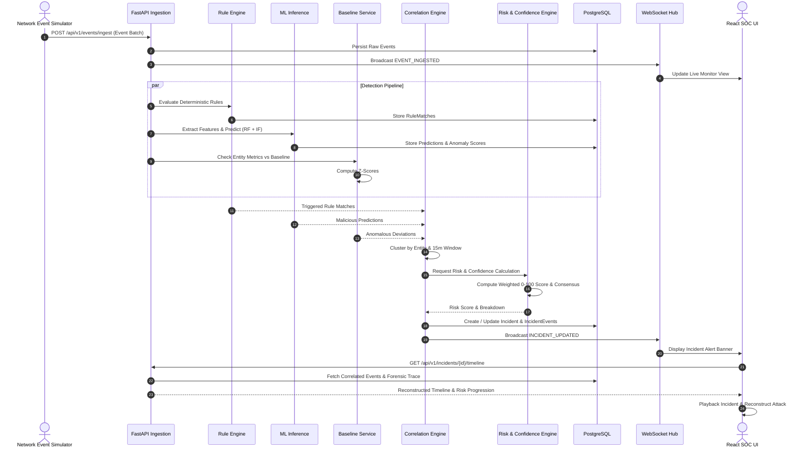

# System Architecture Document

## Intelligent Network Security Monitoring & Attack Reconstruction Platform

---

## 1. Architectural Overview & Philosophy

The **Intelligent Network Security Monitoring & Attack Reconstruction Platform** is built to bridge the gap between simple alert-generating intrusion detection systems and full-scale forensic incident response workflows.

Unlike traditional dashboards that only notify an analyst that "an attack occurred," this system is architected around the core principle of **explainable temporal progression**:
1. **Multi-Signal Detection**: Combines deterministic rules, supervised classification, and unsupervised anomaly detection to minimize single-point-of-failure blind spots.
2. **Behavioral Profiling**: Quantifies how an entity's current activity deviates from its historical normal baseline.
3. **Temporal Attack Reconstruction (Primary USP)**: Reconstructs the end-to-end lifecycle of an attack, allowing analysts to scrub through an interactive timeline, observe risk progression, review evidence changes, and visualize the kill-chain evolution.
4. **Hardware Feasibility**: Designed specifically to run efficiently on standard student hardware using lightweight, explainable models and containerized orchestration.

---

## 2. High-Level System Architecture

```text
                               ┌──────────────────────────────────────────────┐
                               │          NETWORK EVENT SIMULATOR             │
                               │  - Background Normal Telemetry Generator    │
                               │  - Multi-Scenario Attack Generator           │
                               └──────────────────────┬───────────────────────┘
                                                      │ HTTP POST /api/v1/events/ingest
                                                      ▼
                               ┌──────────────────────────────────────────────┐
                               │           FASTAPI INGESTION SERVICE          │
                               │  - Schema Validation (Pydantic v2)           │
                               │  - Event Normalization & Geographic Tagging  │
                               └──────────────────────┬───────────────────────┘
                                                      │
                       ┌──────────────────────────────┴──────────────────────────────┐
                       │                                                             │
                       ▼                                                             ▼
         ┌───────────────────────────┐                                 ┌───────────────────────────┐
         │  DETERMINISTIC RULE       │                                 │   ML INFERENCE SERVICE    │
         │  ENGINE                   │                                 │                           │
         │  - Brute Force Matcher    │                                 │  1. Supervised Classifier │
         │  - Port Scan Sweep        │                                 │     (Random Forest)       │
         │  - Bandwidth Surge        │                                 │  2. Anomaly Detector      │
         │  - Suspicious Port/Proto  │                                 │     (Isolation Forest)    │
         └─────────────┬─────────────┘                                 └─────────────┬─────────────┘
                       │ RuleMatch                                                   │ MLScore & Anomaly
                       └──────────────────────────────┬──────────────────────────────┘
                                                      │
                                                      ▼
                               ┌──────────────────────────────────────────────┐
                               │          BEHAVIORAL BASELINE SERVICE         │
                               │  - Rolling Average & Std Dev (IP/Host/User)  │
                               │  - Z-Score Entity Deviation Assessment       │
                               └──────────────────────┬───────────────────────┘
                                                      │
                                                      ▼
                               ┌──────────────────────────────────────────────┐
                               │          CORRELATION ENGINE                  │
                               │  - Sliding Time-Window Clustering            │
                               │  - Entity-Centric Aggregation                │
                               │  - Kill-Chain Phase Classification           │
                               │  - Incident Creation & Lifecycle Management  │
                               └──────────────────────┬───────────────────────┘
                                                      │
                                                      ▼
                               ┌──────────────────────────────────────────────┐
                               │          RISK & CONFIDENCE ENGINE            │
                               │  - 5-Factor Explainable Risk Scoring (0-100) │
                               │  - Multi-Signal Agreement Calculation        │
                               └──────────────────────┬───────────────────────┘
                                                      │
                                                      ▼
                               ┌──────────────────────────────────────────────┐
                               │          POSTGRESQL DATABASE                 │
                               │  - Normalized Events & Forensic Metadata     │
                               │  - Incidents, Rules, Baselines, Audit Logs   │
                               └──────────────────────┬───────────────────────┘
                                                      │
                                                      ▼
                               ┌──────────────────────────────────────────────┐
                               │          WEBSOCKET BROADCAST SERVICE         │
                               │  - Real-time event streaming                 │
                               │  - Push incident updates & alert broadcasts  │
                               └──────────────────────┬───────────────────────┘
                                                      │ ws://
                                                      ▼
                               ┌──────────────────────────────────────────────┐
                               │          REACT SOC DASHBOARD (VITE)          │
                               │  - Overview & Live Event Monitor             │
                               │  - Interactive Attack Reconstruction (USP)   │
                               │  - Timeline Scrubbing & Step Replay Engine   │
                               │  - Behavioral Deviation Comparison Matrix    │
                               │  - Simulator Execution Control               │
                               └──────────────────────────────────────────────┘
```

---

## 3. Subsystem Breakdown

### 3.1 Event Ingestion Subsystem
- **Purpose**: Intake raw JSON security telemetry, perform Pydantic type validation, normalize timestamps to UTC, extract protocol flags, and store persistent events in PostgreSQL.
- **Components**:
  - `app/api/v1/events.py`: REST endpoint accepting single records or batches.
  - `app/services/event_service.py`: Normalization, persistence, and pipeline dispatch.
  - Asynchronous background task scheduler dispatching events to the detection pipeline without blocking ingestion.

### 3.2 Multi-Signal Detection Subsystem
- **Purpose**: Provide defense-in-depth threat identification across three complementary intelligence mechanisms.
- **Components**:
  - **Deterministic Rule Engine (`app/detection/rules/`)**:
    - Executes stateful and stateless rules using memory-efficient in-memory sliding windows.
    - Emits structured `RuleMatch` models with rule code, severity, and evidence payload.
  - **Supervised Machine Learning Classifier (`ml/inference/predictor.py`)**:
    - Random Forest model evaluating 12 extracted numerical features.
    - Classifies traffic into `Normal`, `PortScan`, `BruteForce`, or `DataExfiltration`.
  - **Unsupervised Anomaly Detector (`ml/inference/predictor.py`)**:
    - Isolation Forest identifying multi-dimensional outliers.
    - Calculates continuous decision function score normalized to $[0, 1]$.
  - **Signal Combiner (`app/detection/signal_combiner.py`)**:
    - Evaluates consensus across rules, classifier, and anomaly detector to output a Detection Confidence rating.

### 3.3 Behavioral Baseline Subsystem
- **Purpose**: Maintain historical activity profiles per entity (Source IP, Host, User) to spot structural shifts in operational patterns.
- **Tracked Parameters**:
  - Hourly connection count
  - Bytes sent & received
  - Unique destination ports contacted
  - Authentication failure rates
- **Mathematical Deviation Engine**:
  - Computes running mean $\mu$ and standard deviation $\sigma$.
  - Generates standard score $Z = \frac{x - \mu}{\sigma + \epsilon}$.
  - Flags moderate deviation ($Z \ge 2.0$) and critical deviation ($Z \ge 3.5$).

### 3.4 Event Correlation Subsystem
- **Purpose**: Transform disconnected logs into cohesive, actionable Incidents.
- **Clustering Heuristics**:
  - **Entity Convergence**: Groups events sharing primary source IP, targeted host, or affected user identity.
  - **Temporal Window**: Events occurring within a sliding 15-minute window are linked to the active incident.
  - **Cyber Kill-Chain Mapping**: Assigns events to stages:
    1. *Reconnaissance* (Port scans, ping sweeps)
    2. *Initial Access* (Failed/successful auth attempts)
    3. *Internal Activity* (Lateral internal movement, database connections)
    4. *Exfiltration* (Large outbound bandwidth on non-standard ports)

### 3.5 Risk & Confidence Engine
- **Purpose**: Produce a transparent, non-black-box risk score from 0 to 100 with clear explainability.
- **Formula**:
  $$\text{Risk} = \min\left(100, W_{\text{rule}} + W_{\text{ml}} + W_{\text{anomaly}} + W_{\text{behavior}} + W_{\text{correlation}}\right)$$
- **Factor Weights**:
  - $W_{\text{rule}} \in [0, 35]$: Severity of highest triggered rule.
  - $W_{\text{ml}} \in [0, 25]$: Machine learning attack probability $\times 25$.
  - $W_{\text{anomaly}} \in [0, 15]$: Normalized Isolation Forest anomaly score $\times 15$.
  - $W_{\text{behavior}} \in [0, 15]$: Scaled entity baseline deviation score.
  - $W_{\text{correlation}} \in [0, 10]$: Incident event count & kill-chain stage progression bonus.
- **Signal Agreement (Confidence)**:
  - Assesses consensus between Rules, Supervised ML, and Anomaly Detector.
  - 3/3 Agreement: High ($90-100\%$)
  - 2/3 Agreement: Moderate ($65-80\%$)
  - 1/3 Agreement: Conflicting Signals ($30-55\%$) $\to$ Triggers "Review Required" status.

### 3.6 Attack Reconstruction Engine (Primary USP)
- **Purpose**: Enable interactive forensic investigation of how an incident developed over time.
- **Reconstruction Output Model**:
  - **Chronological Sequence**: Array of correlated events with sequence indices.
  - **Step-by-Step Risk Progression**: Cumulative risk score at each event timestamp showing exactly when and why risk escalated.
  - **Behavioral Delta Matrix**: Side-by-side comparison of normal entity metrics vs. metrics observed during the attack window.
  - **Interactive Playback State**: Provides playback data payload allowing the React frontend to step forward/backward or auto-play through the incident.

### 3.7 Network Event Simulator Subsystem
- **Purpose**: Standalone generator producing realistic, reproducible normal and attack traffic.
- **Capabilities**:
  - Normal background traffic daemon (HTTP, HTTPS, DNS, standard SSH).
  - 5 On-demand attack scenarios:
    1. Brute Force
    2. Port Scan
    3. Compromised Account
    4. Data Exfiltration
    5. Full Kill-Chain Master Attack Scenario
  - Controlled via REST API (`/api/v1/simulator/*`) and dashboard buttons.

### 3.8 Real-Time Streaming (WebSocket)
- **Purpose**: Low-latency, bidirectional event and notification channel.
- **Path**: `ws://<host>:<port>/api/v1/ws/stream`
- **Payloads**:
  - `EVENT_INGESTED`: New telemetry event recorded.
  - `DETECTION_TRIGGERED`: New rule match or ML anomaly detected.
  - `INCIDENT_UPDATED`: Incident risk escalation or status change.

### 3.9 React SOC Frontend Subsystem
- **Purpose**: Sleek, dark-mode professional analyst dashboard built with React 18, Vite, and Tailwind CSS.
- **Navigation Sections**:
  - **Overview**: High-level SOC metrics, risk meters, active incident counter.
  - **Live Monitor**: Auto-scrolling real-time telemetry stream with severity tags.
  - **Incidents**: Searchable, filterable incident matrix.
  - **Investigation (USP)**: Interactive Attack Reconstruction Studio with timeline slider, playback controls, behavioral diff cards, and evidence viewer.
  - **Analytics**: Historical traffic volume, protocol breakdown, and threat distribution charts.
  - **Detection Rules**: Rule configuration table with threshold editing.
  - **Simulator**: Scenario launch pad for demonstrations.
  - **Settings**: User profile, system health, and audit logs.

---

## 4. End-to-End Data Flow Pipeline



---

## 5. Technology Stack & Architectural Justifications

| Component | Selected Technology | Version | Architectural Justification |
| :--- | :--- | :--- | :--- |
| **Backend Framework** | Python / FastAPI | 3.11+ / 0.111+ | Native asynchronous async/await support, Pydantic v2 data validation, automated OpenAPI docs, and native integration with Python ML libraries. |
| **Database** | PostgreSQL | 16-alpine | Enterprise-grade relational integrity for foreign-key forensic trails, JSONB column support for flexible network telemetry, and optimal indexing. |
| **ORM & Migrations** | SQLAlchemy (Async) / Alembic | 2.0+ / 1.13+ | Clean object-relational mapping with strict typing and reproducible schema versioning migrations. |
| **ML Engine** | Scikit-learn / NumPy | 1.4+ / 1.26+ | Fast CPU-based training and inference ($< 5\text{ ms}$ latency), highly explainable feature importance, low RAM footprint ($< 150\text{ MB}$), zero GPU dependency. |
| **Real-time Protocol** | WebSockets | Native Starlette | Low-overhead bidirectional persistent connection for streaming real-time security events to the frontend. |
| **Frontend Framework** | React + TypeScript + Vite | 18.3+ / 5.2+ | Lightning-fast HMR build times, type safety across API schemas, and robust component lifecycle management for stateful timeline replay. |
| **Styling** | Tailwind CSS | 3.4+ | Rapid development of bespoke, responsive SOC dark-mode user interfaces with consistent design tokens. |
| **Visualization** | Recharts | 2.12+ | Composable, SVG-based charting library tailored for React, supporting smooth animated risk curves and timeline indicators. |
| **Containerization** | Docker & Docker Compose | 24+ / 2.20+ | Eliminates environment discrepancies across student developer machines; single command startup (`docker-compose up --build`). |

---

## 6. Architectural Feasibility & Design Boundaries

To strictly adhere to college project feasibility and academic integrity:
1. **No Expensive Cloud Dependencies**: The system relies on no AWS/GCP/Azure managed services; all components run locally in containers.
2. **No Heavy Neural Networks**: Deep learning frameworks (TensorFlow, PyTorch) are avoided in favor of Scikit-learn Random Forests and Isolation Forests, ensuring instant startup and low memory usage.
3. **Reproducibility**: The integrated simulator ensures that instructors and evaluators can reproduce the exact attack scenario and investigation workflow with a single click.
4. **Defense-Centric Design**: All simulated telemetry is strictly synthetic or benchmark-derived; no live offensive exploits or packet-injection tools are deployed against production networks.
