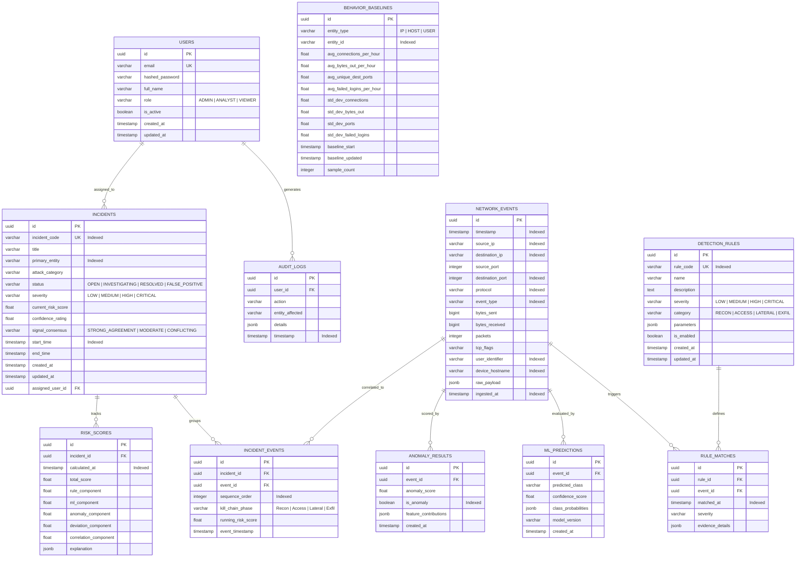

# Database Design & Schema Specification

## Intelligent Network Security Monitoring & Attack Reconstruction Platform

---

## 1. Database Architecture & Design Principles

The database layer uses **PostgreSQL 16** with asynchronous access via **SQLAlchemy 2.0** and **Alembic** migrations.

The database is architected with three guiding principles:
1. **Forensic Immutability**: Raw network telemetry (`network_events`) is treated as an append-only, immutable record. Detection outcomes (`rule_matches`, `ml_predictions`, `anomaly_results`) maintain direct foreign-key references to the raw event.
2. **Relational Integrity**: Foreign keys, check constraints, and unique indexes prevent data corruption and ensure that attack reconstruction queries remain consistent.
3. **Hybrid JSONB Flexibility**: Structured fields (`timestamp`, `source_ip`, `destination_port`, `protocol`) are indexed as first-class relational columns, while raw protocol-specific payloads and evidence details are stored in `JSONB` for deep forensic inspection.

---

## 2. Entity-Relationship (ER) Diagram

---

## 3. Data Dictionary & Detailed Table Specifications

### 3.1 Table: `users`
Stores analyst and administrator user credentials and RBAC roles.

| Column | Type | Constraints | Description |
| :--- | :--- | :--- | :--- |
| `id` | `UUID` | Primary Key, Default: `gen_random_uuid()` | Unique user identifier |
| `email` | `VARCHAR(255)` | Unique, Not Null, Indexed | User login email |
| `hashed_password` | `VARCHAR(255)` | Not Null | Bcrypt hashed password |
| `full_name` | `VARCHAR(100)` | Not Null | Display name of the user |
| `role` | `VARCHAR(20)` | Not Null, Check: `role IN ('ADMIN', 'ANALYST', 'VIEWER')` | RBAC role |
| `is_active` | `BOOLEAN` | Not Null, Default: `TRUE` | Account active flag |
| `created_at` | `TIMESTAMP WITH TIME ZONE` | Not Null, Default: `NOW()` | Account creation time |
| `updated_at` | `TIMESTAMP WITH TIME ZONE` | Not Null, Default: `NOW()` | Last profile update |

### 3.2 Table: `network_events`
Stores raw, immutable network flow and security event telemetry.

| Column | Type | Constraints | Description |
| :--- | :--- | :--- | :--- |
| `id` | `UUID` | Primary Key, Default: `gen_random_uuid()` | Event unique identifier |
| `timestamp` | `TIMESTAMP WITH TIME ZONE` | Not Null, Indexed (DESC) | Telemetry occurrence time |
| `source_ip` | `VARCHAR(45)` | Not Null, Indexed | Source IPv4/IPv6 address |
| `destination_ip` | `VARCHAR(45)` | Not Null, Indexed | Destination IPv4/IPv6 address |
| `source_port` | `INTEGER` | Not Null, Check: `0 <= source_port <= 65535` | Source port |
| `destination_port`| `INTEGER` | Not Null, Check: `0 <= dest_port <= 65535`, Indexed | Destination port |
| `protocol` | `VARCHAR(10)` | Not Null, Indexed | Protocol (TCP, UDP, ICMP, DNS, HTTP, SSH) |
| `event_type` | `VARCHAR(30)` | Not Null, Indexed | Event category (connection, auth, transfer) |
| `bytes_sent` | `BIGINT` | Not Null, Default: 0 | Bytes transmitted by source |
| `bytes_received`| `BIGINT` | Not Null, Default: 0 | Bytes received by source |
| `packets` | `INTEGER` | Default: 1 | Number of packets |
| `tcp_flags` | `VARCHAR(20)` | Nullable | TCP flags observed (e.g. SYN, ACK) |
| `user_identifier`| `VARCHAR(100)` | Nullable, Indexed | Authenticated user identity (if present) |
| `device_hostname`| `VARCHAR(100)` | Nullable, Indexed | Originating device hostname |
| `raw_payload` | `JSONB` | Nullable | Unstructured protocol metadata |
| `ingested_at` | `TIMESTAMP WITH TIME ZONE` | Not Null, Default: `NOW()`, Indexed | System ingestion time |

### 3.3 Table: `detection_rules`
Defines configurable deterministic detection rules.

| Column | Type | Constraints | Description |
| :--- | :--- | :--- | :--- |
| `id` | `UUID` | Primary Key, Default: `gen_random_uuid()` | Unique rule ID |
| `rule_code` | `VARCHAR(30)` | Unique, Not Null, Indexed | Short code (e.g. `RULE-BF-01`) |
| `name` | `VARCHAR(100)` | Not Null | Human-readable rule title |
| `description` | `TEXT` | Not Null | Explanation of the threat logic |
| `severity` | `VARCHAR(15)` | Not Null, Check: `severity IN ('LOW', 'MEDIUM', 'HIGH', 'CRITICAL')` | Threat severity |
| `category` | `VARCHAR(30)` | Not Null | Threat classification |
| `parameters` | `JSONB` | Not Null | Configurable thresholds (window_sec, threshold_count) |
| `is_enabled` | `BOOLEAN` | Not Null, Default: `TRUE` | Enable/disable toggle |
| `created_at` | `TIMESTAMP WITH TIME ZONE` | Not Null, Default: `NOW()` | Creation timestamp |
| `updated_at` | `TIMESTAMP WITH TIME ZONE` | Not Null, Default: `NOW()` | Last modification |

### 3.4 Table: `rule_matches`
Forensic records linking events to the specific rules they violated.

| Column | Type | Constraints | Description |
| :--- | :--- | :--- | :--- |
| `id` | `UUID` | Primary Key, Default: `gen_random_uuid()` | Match record ID |
| `rule_id` | `UUID` | Foreign Key (`detection_rules.id`), Not Null | Triggered rule reference |
| `event_id` | `UUID` | Foreign Key (`network_events.id`), Not Null, Indexed | Triggering event reference |
| `matched_at` | `TIMESTAMP WITH TIME ZONE` | Not Null, Default: `NOW()`, Indexed | Detection time |
| `severity` | `VARCHAR(15)` | Not Null | Severity at time of match |
| `evidence_details`| `JSONB` | Not Null | Specific mathematical/contextual evidence |

### 3.5 Table: `ml_predictions`
Stores supervised Random Forest model inference outputs.

| Column | Type | Constraints | Description |
| :--- | :--- | :--- | :--- |
| `id` | `UUID` | Primary Key, Default: `gen_random_uuid()` | Prediction ID |
| `event_id` | `UUID` | Foreign Key (`network_events.id`), Not Null, Indexed | Evaluated event |
| `predicted_class`| `VARCHAR(30)` | Not Null | Label (`Normal`, `PortScan`, `BruteForce`, `Exfil`) |
| `confidence_score`| `FLOAT` | Not Null | Probability of winning class ($0.0 - 1.0$) |
| `class_probabilities`| `JSONB` | Not Null | Probability breakdown across all classes |
| `model_version`| `VARCHAR(20)` | Not Null | Serialized model artifact tag |
| `created_at` | `TIMESTAMP WITH TIME ZONE` | Not Null, Default: `NOW()` | Evaluation timestamp |

### 3.6 Table: `anomaly_results`
Stores unsupervised Isolation Forest anomaly scores.

| Column | Type | Constraints | Description |
| :--- | :--- | :--- | :--- |
| `id` | `UUID` | Primary Key, Default: `gen_random_uuid()` | Anomaly record ID |
| `event_id` | `UUID` | Foreign Key (`network_events.id`), Not Null, Indexed | Evaluated event |
| `anomaly_score` | `FLOAT` | Not Null | Normalized score ($0.0 - 1.0$) |
| `is_anomaly` | `BOOLEAN` | Not Null, Indexed | True if classified as outlier |
| `feature_contributions`| `JSONB` | Nullable | Relative distance per feature dimension |
| `created_at` | `TIMESTAMP WITH TIME ZONE` | Not Null, Default: `NOW()` | Evaluation timestamp |

### 3.7 Table: `behavior_baselines`
Stores historical statistical baselines per entity.

| Column | Type | Constraints | Description |
| :--- | :--- | :--- | :--- |
| `id` | `UUID` | Primary Key, Default: `gen_random_uuid()` | Baseline record ID |
| `entity_type` | `VARCHAR(20)` | Not Null, Check: `entity_type IN ('IP', 'HOST', 'USER')` | Entity category |
| `entity_id` | `VARCHAR(100)` | Not Null, Indexed | IP address, hostname, or username |
| `avg_connections_per_hour` | `FLOAT` | Not Null, Default: 0.0 | Mean connection rate |
| `avg_bytes_out_per_hour` | `FLOAT` | Not Null, Default: 0.0 | Mean outbound bytes |
| `avg_unique_dest_ports` | `FLOAT` | Not Null, Default: 0.0 | Mean destination port diversity |
| `avg_failed_logins_per_hour` | `FLOAT` | Not Null, Default: 0.0 | Mean failed auth rate |
| `std_dev_connections` | `FLOAT` | Not Null, Default: 1.0 | Standard deviation for connections |
| `std_dev_bytes_out` | `FLOAT` | Not Null, Default: 1.0 | Standard deviation for egress |
| `std_dev_ports` | `FLOAT` | Not Null, Default: 1.0 | Standard deviation for ports |
| `std_dev_failed_logins` | `FLOAT` | Not Null, Default: 1.0 | Standard deviation for auth failures |
| `baseline_start` | `TIMESTAMP WITH TIME ZONE` | Not Null | Profiling period start |
| `baseline_updated` | `TIMESTAMP WITH TIME ZONE` | Not Null, Default: `NOW()` | Last recalculation |
| `sample_count` | `INTEGER` | Not Null, Default: 0 | Number of observation samples |

### 3.8 Table: `incidents`
Aggregates correlated events into security incidents.

| Column | Type | Constraints | Description |
| :--- | :--- | :--- | :--- |
| `id` | `UUID` | Primary Key, Default: `gen_random_uuid()` | Incident ID |
| `incident_code`| `VARCHAR(30)` | Unique, Not Null, Indexed | Identifier (e.g. `INC-2026-0001`) |
| `title` | `VARCHAR(200)` | Not Null | Short descriptive incident title |
| `primary_entity`| `VARCHAR(100)` | Not Null, Indexed | Primary source IP / hostname / user |
| `attack_category`| `VARCHAR(50)` | Not Null | Predominant attack class |
| `status` | `VARCHAR(20)` | Not Null, Check: `status IN ('OPEN', 'INVESTIGATING', 'RESOLVED', 'FALSE_POSITIVE')` | Investigation status |
| `severity` | `VARCHAR(15)` | Not Null, Check: `severity IN ('LOW', 'MEDIUM', 'HIGH', 'CRITICAL')` | Current severity |
| `current_risk_score`| `FLOAT` | Not Null, Default: 0.0 | Transparent 0–100 risk score |
| `confidence_rating` | `FLOAT` | Not Null, Default: 0.0 | Signal agreement percentage ($0.0 - 1.0$) |
| `signal_consensus` | `VARCHAR(25)` | Not Null | `STRONG_AGREEMENT`, `MODERATE`, `CONFLICTING` |
| `start_time` | `TIMESTAMP WITH TIME ZONE` | Not Null, Indexed | Timestamp of first event |
| `end_time` | `TIMESTAMP WITH TIME ZONE` | Not Null | Timestamp of most recent event |
| `created_at` | `TIMESTAMP WITH TIME ZONE` | Not Null, Default: `NOW()` | Inception time |
| `updated_at` | `TIMESTAMP WITH TIME ZONE` | Not Null, Default: `NOW()` | Last escalation time |
| `assigned_user_id` | `UUID` | Foreign Key (`users.id`), Nullable | Assigned investigator |

### 3.9 Table: `incident_events`
Cross-reference table linking events to an incident with sequential and kill-chain metadata.

| Column | Type | Constraints | Description |
| :--- | :--- | :--- | :--- |
| `id` | `UUID` | Primary Key, Default: `gen_random_uuid()` | Mapping ID |
| `incident_id` | `UUID` | Foreign Key (`incidents.id`), Not Null, Indexed | Parent incident |
| `event_id` | `UUID` | Foreign Key (`network_events.id`), Not Null, Indexed | Correlated event |
| `sequence_order`| `INTEGER` | Not Null, Indexed | Step number in timeline ($1, 2, 3...$) |
| `kill_chain_phase`| `VARCHAR(40)` | Not Null | `Reconnaissance`, `Initial Access`, `Lateral Movement`, `Exfiltration` |
| `running_risk_score`| `FLOAT` | Not Null | Risk score at this specific point in time |
| `event_timestamp`| `TIMESTAMP WITH TIME ZONE` | Not Null, Indexed | Event timestamp |

### 3.10 Table: `risk_scores`
Forensic history of risk score calculations and factor breakdowns.

| Column | Type | Constraints | Description |
| :--- | :--- | :--- | :--- |
| `id` | `UUID` | Primary Key, Default: `gen_random_uuid()` | Score calculation ID |
| `incident_id` | `UUID` | Foreign Key (`incidents.id`), Not Null, Indexed | Associated incident |
| `calculated_at` | `TIMESTAMP WITH TIME ZONE` | Not Null, Default: `NOW()`, Indexed | Timestamp of calculation |
| `total_score` | `FLOAT` | Not Null | Cumulative score ($0 - 100$) |
| `rule_component` | `FLOAT` | Not Null | Rule severity contribution ($0 - 35$) |
| `ml_component` | `FLOAT` | Not Null | ML classification contribution ($0 - 25$) |
| `anomaly_component`| `FLOAT`| Not Null | Anomaly score contribution ($0 - 15$) |
| `deviation_component`| `FLOAT`| Not Null | Behavioral Z-score contribution ($0 - 15$) |
| `correlation_component`| `FLOAT`| Not Null| Event correlation bonus ($0 - 10$) |
| `explanation` | `JSONB` | Not Null | Human-readable factor breakdown |

### 3.11 Table: `audit_logs`
Tracks administrative and analyst modifications for auditability.

| Column | Type | Constraints | Description |
| :--- | :--- | :--- | :--- |
| `id` | `UUID` | Primary Key, Default: `gen_random_uuid()` | Audit log ID |
| `user_id` | `UUID` | Foreign Key (`users.id`), Nullable | Acting user (Null for system) |
| `action` | `VARCHAR(50)` | Not Null | Action name (e.g. `STATUS_CHANGE`, `RULE_UPDATE`) |
| `entity_affected`| `VARCHAR(100)` | Not Null | ID of modified entity |
| `details` | `JSONB` | Not Null | Diff or parameters of change |
| `timestamp` | `TIMESTAMP WITH TIME ZONE` | Not Null, Default: `NOW()`, Indexed | Occurrence timestamp |

---

## 4. Indexing & Query Optimization Strategy

1. **High-Frequency Ingestion**:
   - `network_events(timestamp DESC)`: For live monitor ordering and time-bounded range filtering.
   - `network_events(source_ip, timestamp)`: Composite index for entity sliding-window lookups.
   - `network_events(destination_ip, destination_port)`: For port scanning detection queries.
2. **Attack Reconstruction Lookups**:
   - `incident_events(incident_id, sequence_order ASC)`: Enables lightning-fast ($< 20\text{ ms}$) retrieval of the complete sequential timeline.
3. **Foreign Key Integrity**:
   - Explicit indexes on all foreign key columns (`rule_matches.event_id`, `ml_predictions.event_id`, `anomaly_results.event_id`, `risk_scores.incident_id`) to optimize join performance during deep-dive investigations.

---

## 5. Seed Data Strategy

To allow immediate platform demonstration upon startup, the database seed script (`backend/app/db/seed.py`) will automatically provision:
- **Default Administrative User**: `admin@soc.local` (Password: `Admin@12345`)
- **Default Analyst User**: `analyst@soc.local` (Password: `Analyst@12345`)
- **Core Detection Rules**: 6 active, pre-configured rules (`RULE-BF-01`, `RULE-PS-01`, `RULE-BW-01`, `RULE-SP-01`, `RULE-RF-01`, `RULE-EX-01`).
- **Initial Entity Baselines**: Pre-seeded statistical baseline profiles for standard internal hosts (`192.168.1.100`, `192.168.1.105`, `192.168.1.200`).
